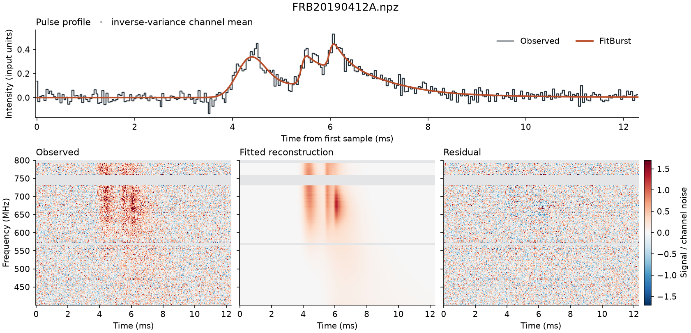

# Burst Surveyor

FitBurst reconstruction of dedispersed radio bursts. Give the AI this checkout and the NPZ directory.

> Follow [AGENTS.md](AGENTS.md). Fit `INPUTS` into `WORK`. Return the verified figures and event table.

**FRB 20190412A.** Three overlapping peaks and a long tail. The five-component reconstruction improved weighted gain by 9.7% over our earlier two-component fit. Some frequency structure remains in the residual. [CHIME/FRB observation](https://chime-frb.ca/catalogs/basecat1/FRB20190412A) · [Catalog paper](https://arxiv.org/abs/2311.00111)

**Seven synthetic pulses.** The first fit missed the pulse at 135 ms. The follow-up raised weighted reconstruction gain by 8.6%. [NPZ](examples/seven-pulse.npz)

**Two synthetic pulses.** The first fit recovered both. [NPZ](examples/two-pulse.npz)

