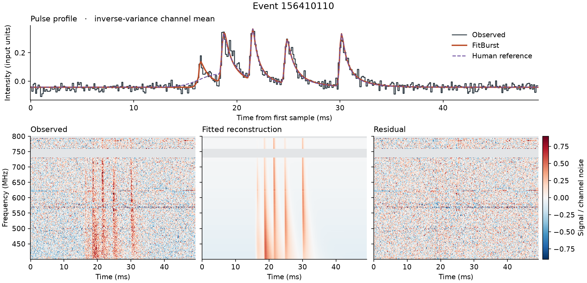
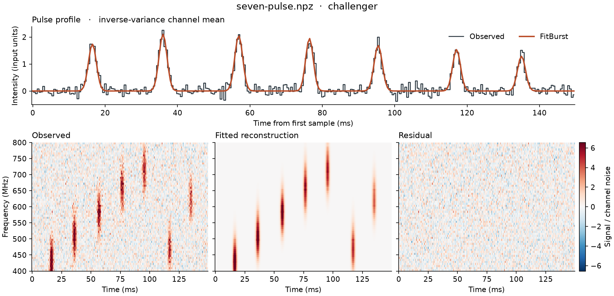

# burst surveyor

burst surveyor fits dedispersed radio bursts with FitBurst, using a coding agent to run the fitting and review workflow. Give your agent this repository and your observations, and ask it to follow [AGENTS.md](AGENTS.md).

The examples below show the observed pulse profile and spectrum alongside the fitted reconstruction and residuals. A human reference is included where available.

### FRB 20190412A

### Event 156410110

### Seven pulses

A synthetic example after a follow-up fit recovered a missed pulse.

The agent inspects each fit and returns figures and verified reports, leaving persistent or ambiguous problems marked for review so that you can focus on the events that need attention. Model components can overlap in time and frequency, so they should not automatically be interpreted as separate physical pulses.

Observations and generated reports stay local, and the [guide](docs/guide.md) explains the [input format](docs/reference.md), installation and fitting workflow in more detail.
