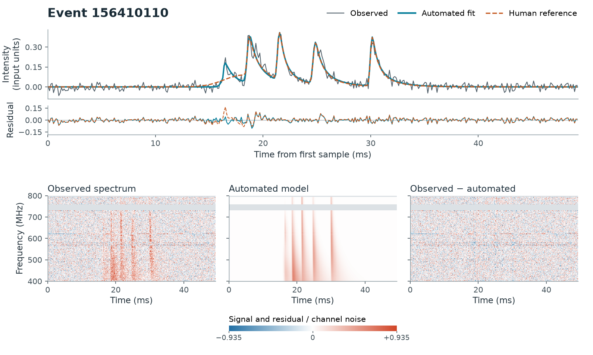
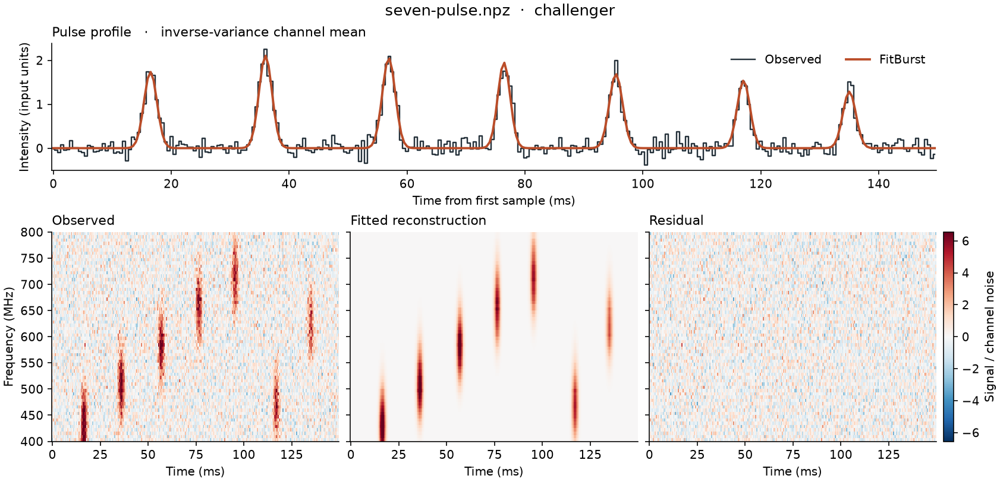
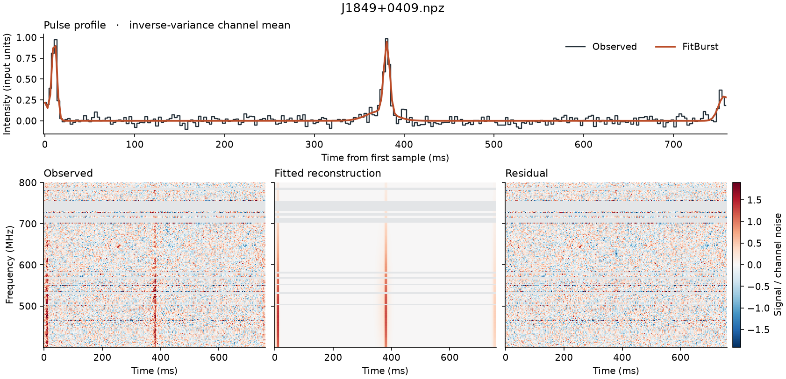

# burst surveyor

burst surveyor fits dedispersed radio bursts and folded pulsar profiles with FitBurst. It automatically fits candidate models to the observed intensity and exports the selected reconstruction on the original frequency and time grid.

## Fit an observation

From the repository root, install the package in a fresh 64-bit Python 3.12 environment and fit the bundled two-pulse example.

```sh
python -m pip install -c constraints.txt ./vendor/fitburst-0.1.0-py3-none-any.whl .
python -m burstsurveyor fit examples/two-pulse.npz run --workers 1
python -m burstsurveyor verify run
```

`run/results.json` records the fit status, component count and scores for each observation. For an exported fit, the `prediction` field gives the path to the reconstructed array relative to `run`. To fit several observations, pass a directory of [NPZ files](docs/reference.md) in place of the example. Use a new output directory for each run.

## Burst examples

The examples below show the observed pulse profile and spectrum alongside the fitted reconstruction and residuals. Model components can overlap in time and frequency, so they should not automatically be interpreted as separate physical pulses.

### FRB 20190412A


### Event 156410110



### Seven pulses

The initial fit recovered six of the seven injected pulses. A positive residual triggered a follow-up fit that recovered the seventh.



## Pulsars

[Pulsar mode](docs/selection.md#pulsar-profiles) fits one complete rotation, including emission across the phase boundary, and compares models with and without scattering.

### J1849+0409



### J0824+0028


## Optional review

To generate figures and screen for possible missed components, use `prepare` as described in the [guide](docs/guide.md#figures-and-residuals). For review with a coding agent, see [AI-assisted review](docs/ai-assisted-review/README.md).
