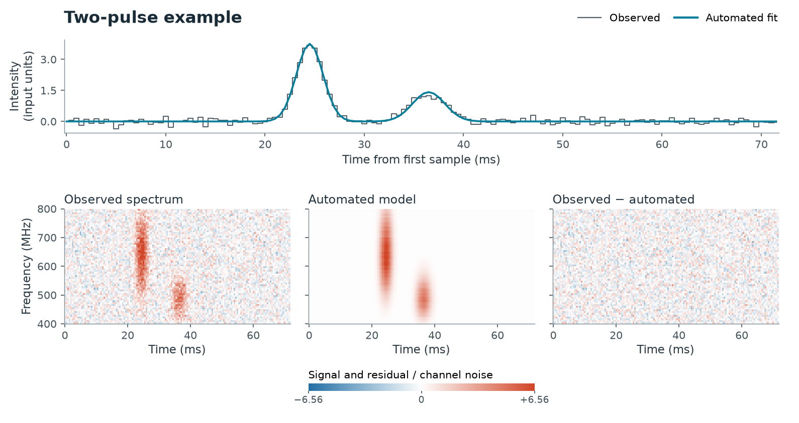
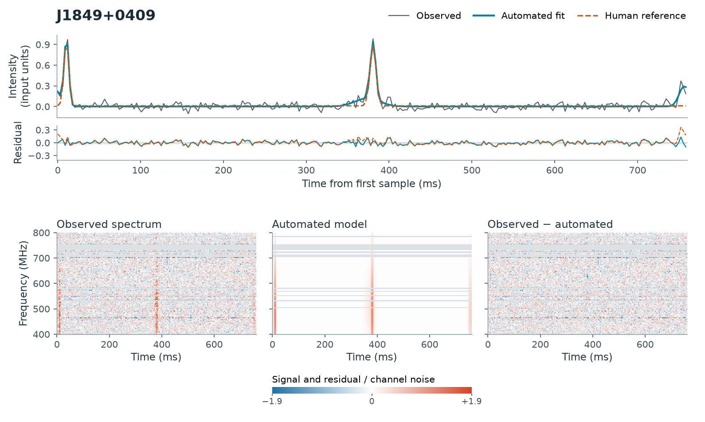

# burst surveyor

burst surveyor fits dedispersed radio bursts and folded pulsar profiles with [FitBurst](https://github.com/CHIMEFRB/fitburst). It automatically fits candidate models to the observed intensity and exports the selected reconstruction on the original frequency and time grid.

## How the fit works

The input is a dynamic spectrum, the observed intensity as a function of frequency and time. To find starting parameters, burst surveyor averages the usable channels into time profiles over the full band, halves and quarters. It searches each profile for peaks at several smoothing widths. A pulse confined to the lower half of the band can stand out there even when it is weak in the full-band average.

The default burst search uses those peaks to initialize Gaussian components, then fits their sum to the dynamic spectrum. Each component has its own arrival time, width, fluence and spectrum. The components share a residual dispersion measure. The search tries models with and without a scattering tail and checks the residuals for structure that could justify another component.

Candidates are compared on the original frequency and time grid. The score measures how much the model reduces the noise-weighted sum of squared residuals relative to a baseline alone. Selection penalizes extra parameters and favors a simpler model when scores are close. FitBurst then renders the selected model on the original grid, and burst surveyor scores the exported reconstruction. The run records the alternatives so the choice can be inspected. [Selection details](docs/selection.md#default-burst-search)

## Fit an observation

In a fresh 64-bit Python 3.12 environment, install burst surveyor and FitBurst, then generate and fit the two-pulse example.

```sh
python -m pip install -c https://github.com/ImmortalAri/burst-surveyor/releases/download/v0.1.0/constraints.txt https://github.com/ImmortalAri/burst-surveyor/releases/download/v0.1.0/fitburst-0.1.0-py3-none-any.whl https://github.com/ImmortalAri/burst-surveyor/releases/download/v0.1.0/burst_surveyor-0.1.0-py3-none-any.whl
burstsurveyor example two-pulse.npz
burstsurveyor fit two-pulse.npz run --workers 1
burstsurveyor verify run
```

`run/results.json` records the fit status, component count and scores for each observation. For an exported fit, the `prediction` field gives the path to the reconstructed array relative to `run`. To fit several observations, pass a directory of [NPZ files](docs/reference.md) in place of the example. Use a new output directory for each run.

The example contains pulses centred at 24.5 and 36.5 ms. The search finds the first peak in the full-band profile and the second in the lower half of the band. A single scattered component at the first peak gives a gain of 5417.72. Two Gaussian components give 7085.52. Adding a scattering tail to the two-component model gives 7085.45. The search selects two components without scattering. After refinement their arrival times at 600 MHz are 24.49 and 36.58 ms.

In the figure, compare the observed and modeled spectra at the second peak. Both concentrate the later emission at lower frequencies. The residual panel shows what remains after subtracting the model.



## Fast radio burst examples

The three BaseCat2 examples compare the automated fit with a human reference on the same time grid. Each figure shows the pulse profiles, the observed dynamic spectrum, both model spectra and the residuals (observed minus modeled intensity). Gray bands mark masked channels. Model components can overlap in time and frequency, so they should not automatically be interpreted as separate physical pulses.

### Event 156410110

Both fits follow the main peaks. The automated fit uses six components and follows the smaller peak near 16.5 ms more closely than the five-component human reference.


### Event 300938875

The automated fit recovers a peak near 3.2 ms that is absent from the saved human reference candidate. The atlas records no final human selection for this event. The weaker feature near 4.6 ms remains uncertain.


### Event 1114368517

Both fits use one component and give similar pulse profiles. At 600 MHz, the automated fit selects zero scattering and the human reference gives 0.123 ms. The time bin is 0.655 ms.


### FRB 20190412A

The observed pulse profile and spectrum are shown alongside the fitted reconstruction and residuals.


## Pulsars

[Pulsar mode](docs/selection.md#pulsar-profiles) fits one complete rotation, including emission across the phase boundary, and compares models with and without scattering.

### J1849+0409

The two fits follow the main pulse and interpulse. The largest difference between the profiles occurs near the rotation boundary.



### J0824+0028


## Optional review

To generate figures and screen for possible missed components, use `prepare` as described in the [guide](docs/guide.md#figures-and-residuals). For review with a coding agent, see [AI-assisted review](docs/ai-assisted-review/README.md).

## Citation

If you publish results obtained with burst surveyor, cite the software and the FitBurst paper by Fonseca et al. (2024). [Software citation](CITATION.cff) · [FitBurst repository](https://github.com/CHIMEFRB/fitburst) · [FitBurst paper](https://doi.org/10.3847/1538-4365/ad27d6)
