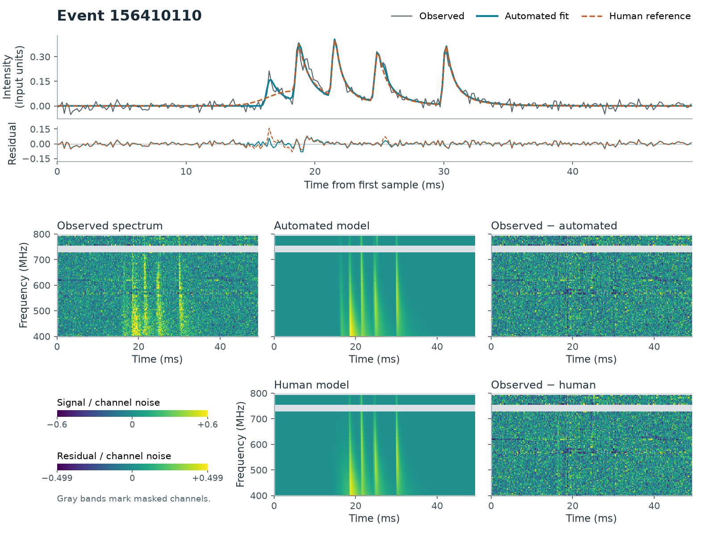
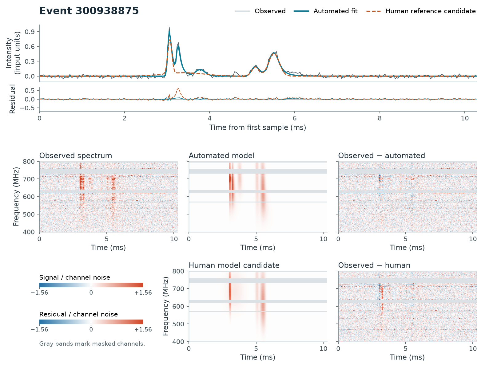
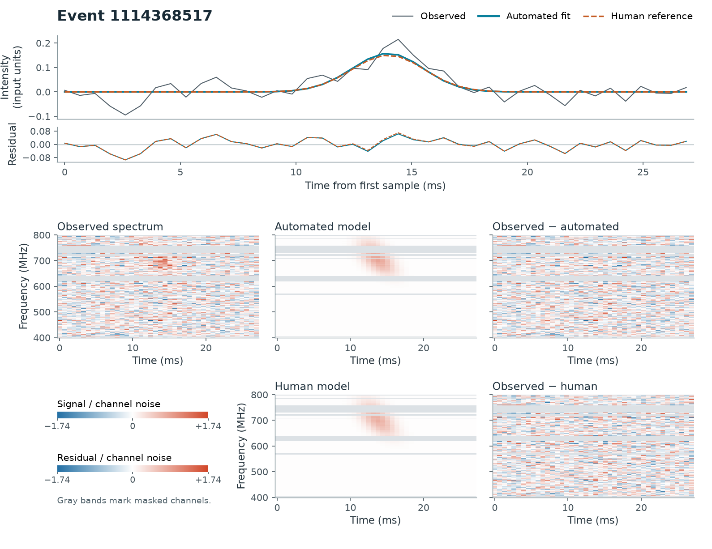
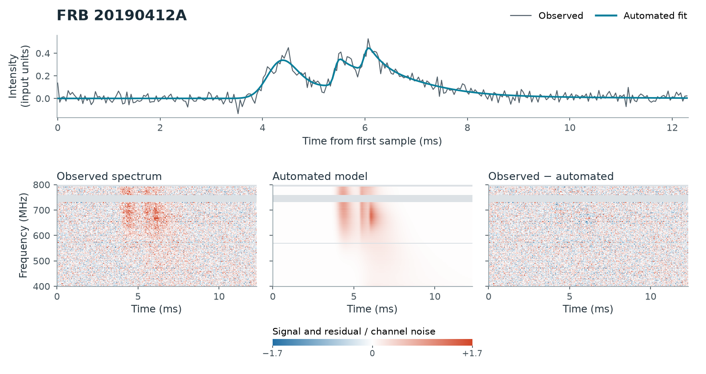
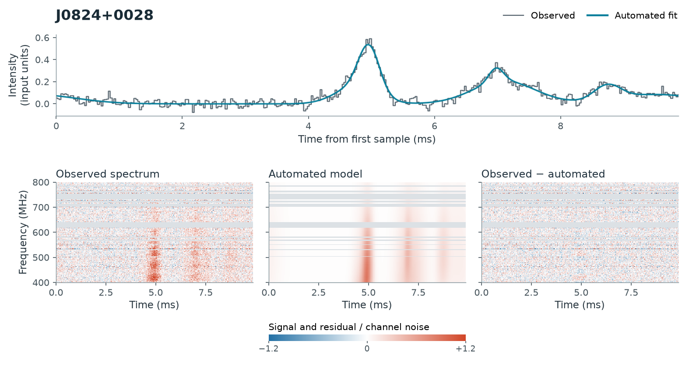

# burst surveyor

burst surveyor fits dedispersed radio bursts and folded pulsar profiles with FitBurst. It automatically fits candidate models to the observed intensity and exports the selected reconstruction on the original frequency and time grid.

## Fit an observation

From the repository root, install the package in a fresh 64-bit Python 3.12 environment and fit the bundled two-pulse example.

```sh
python -m pip install -c constraints.txt ./vendor/fitburst-0.1.0-py3-none-any.whl .
python -m burstsurveyor fit examples/two-pulse.npz run --workers 1
python -m burstsurveyor verify run
```

`run/results.json` records the fit status, component count and scores for each observation. For an exported fit, the `prediction` field gives the path to the reconstructed array relative to `run`. To fit several observations, pass a directory of [NPZ files](docs/reference.md) in place of the example. Use a new output directory for each run.

## Burst examples

The BaseCat2 examples show the observed pulse profile, the automated fit and a human reference on the same time grid. The lower panel shows the observed intensity minus each model. Model components can overlap in time and frequency, so they should not automatically be interpreted as separate physical pulses.

### Event 156410110

Both fits follow the main peaks. The automated fit uses six components and follows the smaller peak near 16.5 ms more closely than the five-component human reference.



[Observed spectrum, fitted reconstruction and residuals for event 156410110](examples/real-multipulse.png)

### Event 300938875

The automated fit recovers a peak near 3.2 ms that is absent from the saved human reference candidate. The atlas records no final human selection for this event. The weaker feature near 4.6 ms remains uncertain.



### Event 1114368517

Both fits use one component and give similar pulse profiles. At 600 MHz, the automated fit selects zero scattering and the human reference gives 0.123 ms. The time bin is 0.655 ms.



### FRB 20190412A

The observed pulse profile and spectrum are shown alongside the fitted reconstruction and residuals.



## Pulsars

[Pulsar mode](docs/selection.md#pulsar-profiles) fits one complete rotation, including emission across the phase boundary, and compares models with and without scattering.

### J1849+0409

The two fits follow the main pulse and interpulse. The largest difference between the profiles occurs near the rotation boundary.


[Observed spectrum, fitted reconstruction and residuals for J1849+0409](examples/pulsar-j1849-0409.png)

### J0824+0028



## Optional review

To generate figures and screen for possible missed components, use `prepare` as described in the [guide](docs/guide.md#figures-and-residuals). For review with a coding agent, see [AI-assisted review](docs/ai-assisted-review/README.md).
