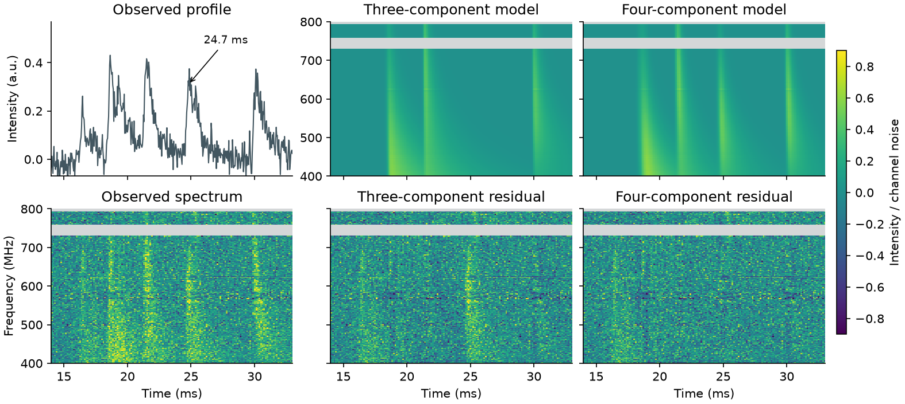
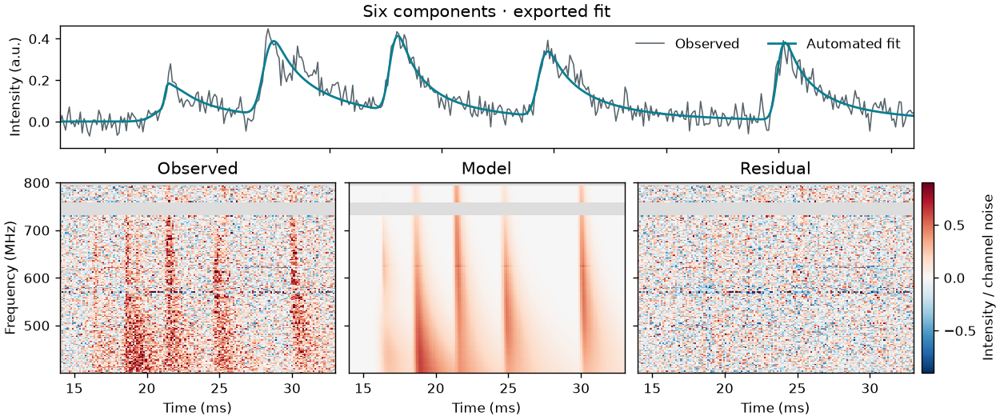

# burst surveyor

burst surveyor automatically fits dedispersed radio bursts and folded pulsar profiles. It estimates starting parameters from the observed intensity, compares models with different component counts and with or without scattering, and exports the selected model on the original frequency and time grid. The default burst fit uses Surveyor’s bin-integrated pulse model throughout. [FitBurst](https://github.com/CHIMEFRB/fitburst) is available for reference exports and is required for folded pulsar and experimental spectral modes.

## Fit an observation

Use a fresh 64-bit CPython 3.15 environment. We recommend the [standard Python 3.15.2 build](https://www.python.org/downloads/release/python-3152/). To install from PyPI and fit the bundled two-pulse example, run

```sh
python -m pip install burst-surveyor
burstsurveyor example two-pulse.npz
burstsurveyor fit two-pulse.npz run --workers 1
burstsurveyor verify run
```

[GitHub wheels, installation from source and optional FitBurst support](https://github.com/ImmortalAri/burst-surveyor/blob/v0.4.0/docs/guide.md#installation)

The fit recovers two components near 24.5 and 36.5 ms and selects zero scattering. `run/results.json` records the component count, scores and path to the reconstruction. To fit your own data, replace `two-pulse.npz` with an [observation in NPZ format](https://github.com/ImmortalAri/burst-surveyor/blob/v0.4.0/docs/reference.md) or a directory of observations. Use a new output directory for each run. The default burst fit uses [measured channel time offsets](https://github.com/ImmortalAri/burst-surveyor/blob/v0.4.0/docs/reference.md#channel-timing) when the input supplies them.

## How the fit works

For a burst, the search averages usable frequency channels over the full band, halves and quarters. It looks for peaks at several smoothing widths. Their positions and widths supply starting estimates for Gaussian components, which are fitted jointly to the dynamic spectrum. The search tests models with and without a scattering tail and checks the residuals for missed emission. It scores each candidate by the reduction in noise-weighted squared error on the original grid and favors simpler fits when scores are close.

The [methods walkthrough](https://github.com/ImmortalAri/burst-surveyor/blob/v0.4.0/docs/methods.md) follows the bundled observation from its first peak guesses through the scoring and stopping rules to the saved model and residuals.

### Worked example for BaseCat2 event 156410110

Burst Surveyor v0.3.0 found three initial peaks near 18.7, 21.6 and 30.1 ms on this observation's shared time grid. The three-component fit with scattering left a peak near **24.7 ms** in the residual, which is the observed intensity minus the fitted model. The search used that peak to seed a fourth component and refitted the model jointly. Most of the residual emission at 24.7 ms disappears in the four-component fit. An earlier feature near **16.3 ms** remains.

[](https://immortalari.github.io/burst-surveyor/)

The gain measures how much a fit reduces noise-weighted squared error relative to a constant baseline per channel. The table shows the rounded gains on the observation grid.

| Components | Gain | What changed |
| --- | ---: | --- |
| 3 | 6,928 | Fit the three peaks found in the initial search. |
| 4 | 8,561 | Add a component near 24.7 ms from the residual. |
| 5 | 9,176 | Add a component near 16.3 ms from the remaining residual. |
| **6 · selected** | **9,229** | Split the early feature into two overlapping components with different spectra. |

#### Selected fit with six components

The final split adds 53 gain units. That exceeds the roughly nine-unit difference within which the [refinement prefers a simpler fit](https://github.com/ImmortalAri/burst-surveyor/blob/v0.4.0/docs/methods.md#choosing-a-model-and-deciding-when-to-stop). At 600 MHz the two overlapping components have fitted arrival times of **16.19 and 16.36 ms**. The number of physical pulses in the early feature remains uncertain.



[Step through all four fits on the same scales.](https://immortalari.github.io/burst-surveyor/)

The [fit gallery](https://github.com/ImmortalAri/burst-surveyor/blob/v0.4.0/examples/README.md) includes other fast radio bursts, folded pulsar profiles and the bundled example. The [selection guide](https://github.com/ImmortalAri/burst-surveyor/blob/v0.4.0/docs/selection.md) describes the search in each fitting mode.

The [validation results](https://github.com/ImmortalAri/burst-surveyor/blob/v0.4.0/docs/validation.md) compare reconstructions with the CHIME/FRB Catalog 2 fits and report false splits and weak-pair recovery in blind pulse injections.

## Reviewing fits

Use [`prepare`](https://github.com/ImmortalAri/burst-surveyor/blob/v0.4.0/docs/guide.md#figures-and-residuals) to generate figures and screen for possible missed components. You can inspect the results yourself or use the [optional AI-assisted review instructions](https://github.com/ImmortalAri/burst-surveyor/blob/v0.4.0/docs/ai-assisted-review/README.md).

For a completed bounded fit, [`route-rescue`](https://github.com/ImmortalAri/burst-surveyor/blob/v0.4.0/docs/selection.md#opt-in-rescue-routing) can try one targeted refit when the observed residual supports it. The synthetic example shows how it separates two blended peaks.

## Citation

If you publish results obtained with burst surveyor, cite [the software](https://github.com/ImmortalAri/burst-surveyor/blob/v0.4.0/CITATION.cff) and [Fonseca et al. (2024)](https://doi.org/10.3847/1538-4365/ad27d6).
