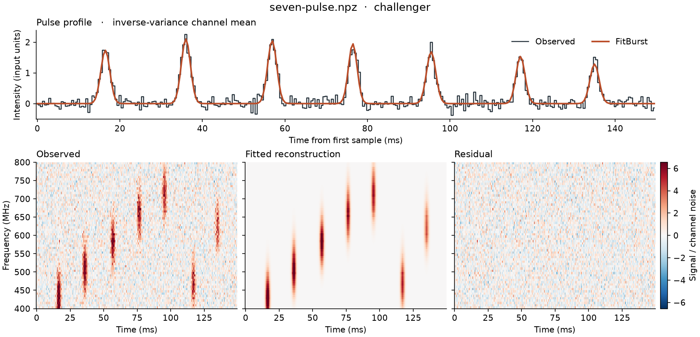
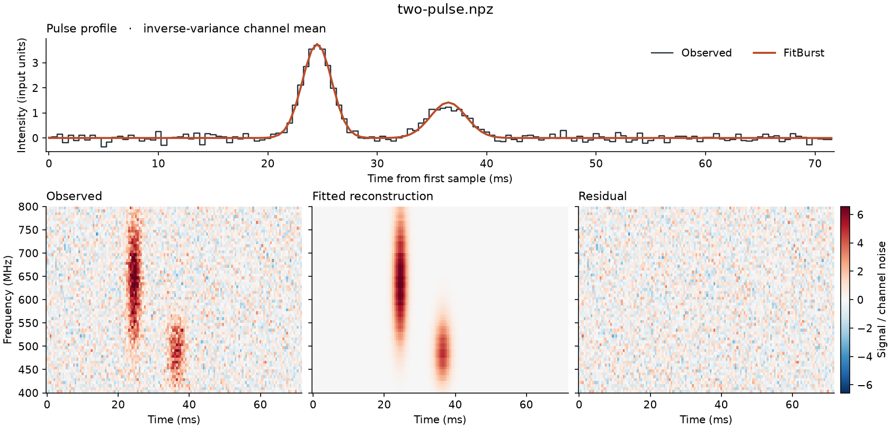

# Using burst surveyor

Burst Surveyor provides an AI-assisted workflow around FitBurst: fit local dedispersed observations, inspect the results, attempt bounded follow-ups, and return verified reports. [AGENTS.md](../AGENTS.md) is the authoritative workflow for coding agents. The [README](../README.md) explains how to hand the repository to a coding agent.

## Install and prepare

From the repository root, inside a fresh 64-bit Python 3.12 environment:

```sh
python -m pip install -c constraints.txt ./vendor/fitburst-0.1.0-py3-none-any.whl .
python -m burstsurveyor doctor
python -m burstsurveyor prepare INPUTS WORK --workers 1
```

`INPUTS` is one dedispersed [NPZ file](reference.md) or a directory. `WORK` must be an unused directory. Follow the package's worker and memory guards. Resume an interrupted preparation with the same arguments and `--resume`.

## What the agent does

1. Fits the observations and exports native-grid reconstructions.
2. Opens every selected figure and component table, checking the observed spectrum, pulse profile, model and residuals.
3. Inspects any follow-up, including rejected trials, and records an explicit decision for each event.
4. Finishes with verified reports and identifies cases needing human attention.

The local review queue is `WORK/review/review.html`. Missing fits or unavailable inspections appear first, followed by likely missed-component alerts. Other diagnostic notes remain informational. Routine events still require the agent's visual review; the queue does not guarantee that every pulse was found.

The stable default permits at most one guarded temporal rescue per event. An alert requires replicated missing observed morphology across channel folds, rather than spectral mismatch or an in-pulse shape residual alone. Persistent or ambiguous problems remain marked for review. See [priority definitions](review-queue.md).

The agent writes decisions using the current packet hashes, then runs:

```sh
python -m burstsurveyor decide WORK INPUTS decisions.json
python -m burstsurveyor finish WORK
```

Follow-up packets have new hashes. Use the returned hash for the terminal decision; the original index retains the initial one. Full decision fields and stopping rules are in [AGENTS.md](../AGENTS.md).

## Outputs

| Output | Purpose |
|---|---|
| `review/review.html` | Ranked figures and diagnostic notes |
| Figures | Profiles, observed spectra, reconstructions and residuals |
| `decisions.json` | Inspection evidence bound to input and packet hashes |
| `report.csv`, `report.json` | Verified event dispositions and results |

Observations, reference files and generated reports remain local. Selected real-burst illustrations appear in the README; raw observations and human-reference parameter files are not bundled with those figures.

## Scores and interpretation

`gain` measures the reduction in weighted squared error relative to a constant baseline per channel. `rms_gain` uses alternate RMS weights. A follow-up must pass a separate channel check and improve both scores on the exported pixels. A higher gain alone does not establish another physical pulse.

Overlapping model terms can describe different frequency bands or trade off with intrinsic width, residual DM and scattering. Component count need not equal peak count. Sub-bin widths, broad components, crop sensitivity and spectral limitations receive informational notes; these do not measure parameter stability or replace uncertainty analysis. Retaining a reconstruction does not certify a unique physical interpretation.

## Selection modes and existing runs

The default `--mode bounded` preserves the stable fitter. The optional `--mode combined` compares smooth and flexible spectral amplitudes using predictive parsimony and replicated pulse coverage. `--mode scintillation` offers flexible spectral amplitudes without that combined coverage search. Both alternatives are experimental and can change DM, scattering and widths. They use internal bounded searches; external challenges are supported only in bounded mode. See [selection modes](selection.md).

To generate a review queue for a sealed numerical run without repeating fits:

```sh
python -m burstsurveyor triage RUN INPUTS NEW_OUTPUT
```

This is a diagnostic audit, not a completed assessment.

## Synthetic controls

These small bundled inputs exercise the workflow. They complement the real observations shown in the README.

**Seven pulses.** A control for pulse coverage and guarded rescue. [Input NPZ](../examples/seven-pulse.npz).



**Two pulses.** A simple reconstruction control. [Input NPZ](../examples/two-pulse.npz).


