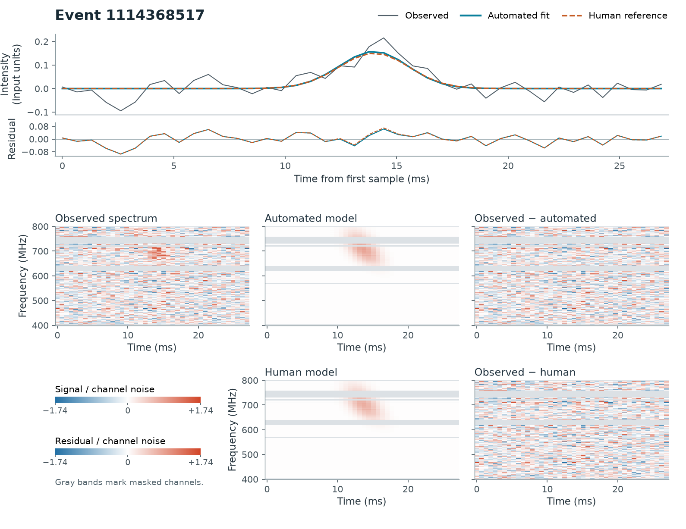
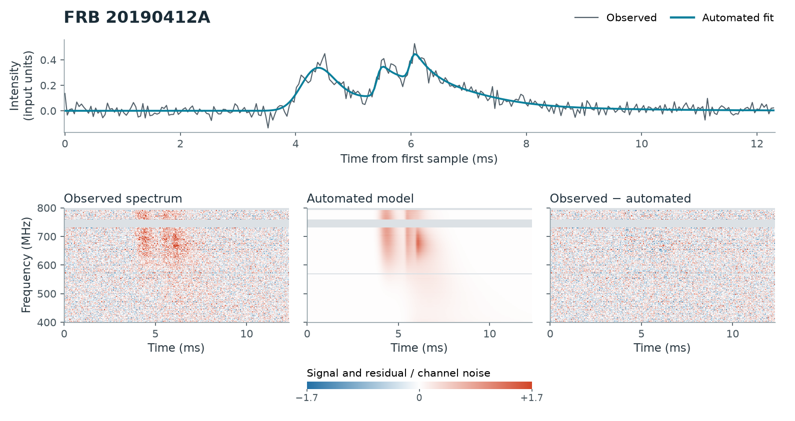

# Fit gallery

## Fast radio burst examples

The three BaseCat2 examples compare the automated fit with a human reference on the same time grid. Each figure shows the pulse profiles, the observed dynamic spectrum, both model spectra and the residuals (observed minus modeled intensity). Gray bands mark masked channels. Model components can overlap in time and frequency, so they should not automatically be interpreted as separate physical pulses.

### Event 156410110

Both fits follow the main peaks. The automated fit uses six components and follows the smaller peak near 16.5 ms more closely than the five-component human reference. [Explore the automated fit stages.](https://immortalari.github.io/burst-surveyor/)

### Event 300938875

The automated fit recovers a peak near 3.2 ms that is absent from the saved human reference candidate. The atlas records no final human selection for this event. The weaker feature near 4.6 ms remains uncertain.

### Event 1114368517

Both fits use one component and give similar pulse profiles. At 600 MHz, the automated fit selects zero scattering and the human reference gives 0.123 ms. The time bin is 0.655 ms.

### FRB 20190412A

The observed pulse profile and spectrum are shown alongside the fitted reconstruction and residuals.

## Pulsars

[Pulsar mode](../docs/selection.md#pulsar-profiles) fits one complete rotation, including emission across the phase boundary, and compares models with and without scattering.

### J1849+0409

The two fits follow the main pulse and interpulse. The largest difference between the profiles occurs near the rotation boundary.

### J0824+0028

## Bundled two-pulse example

The search finds a peak at 24.5 ms in the full band and a weaker peak at 36.5 ms in the lower half of the band. It tries both a single scattered pulse and a model with two pulses. [Compare the observation, fits and residuals.](https://immortalari.github.io/burst-surveyor/two-pulse.html)

The single scattered pulse gives a gain of 5417.72. Two Gaussian components give 7085.52, and adding scattering gives 7085.45. The search selects two components without scattering. After refinement their arrival times at 600 MHz are 24.49 and 36.58 ms.

