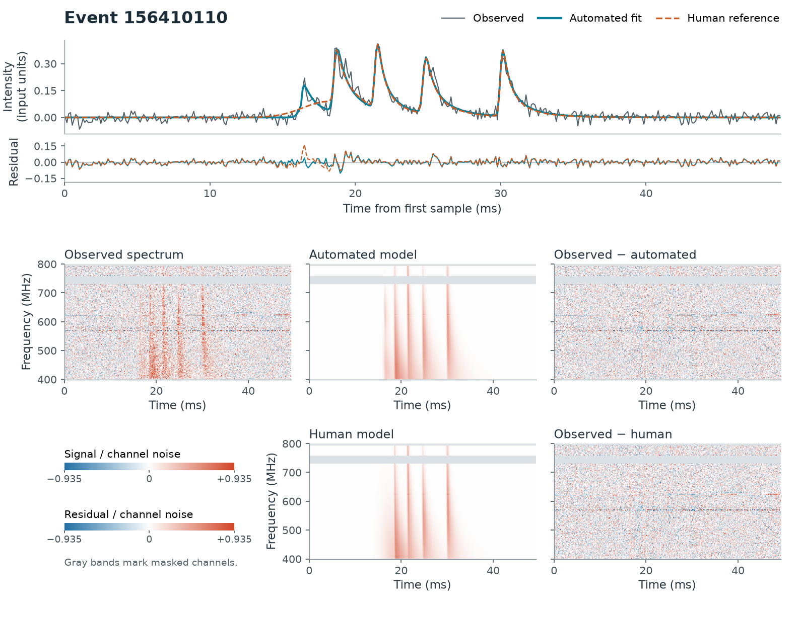
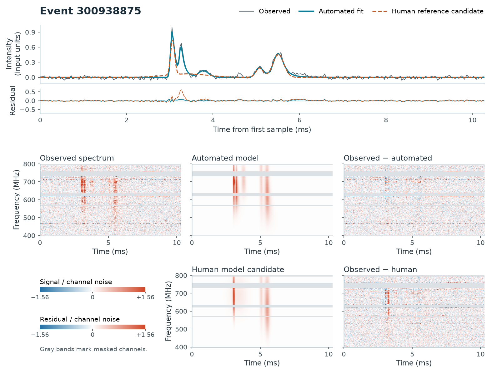
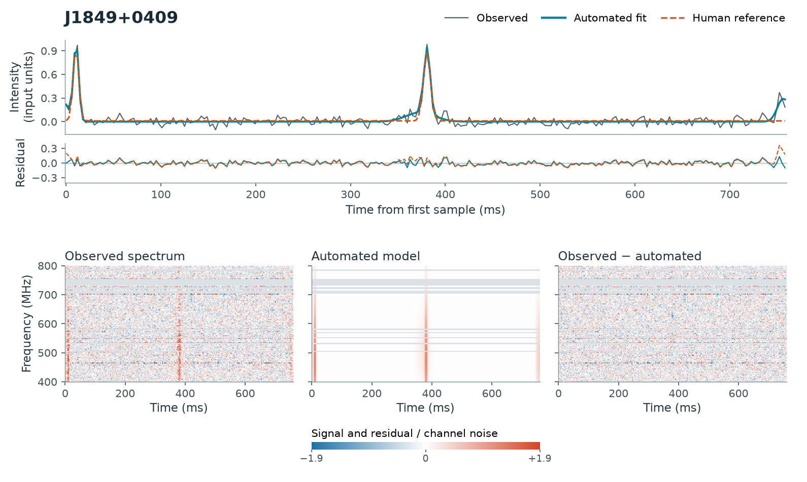
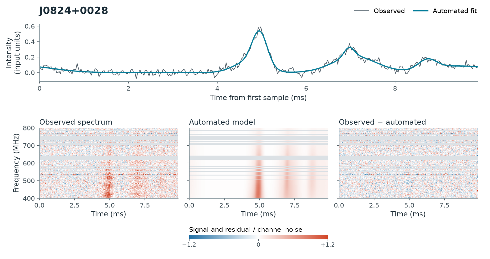
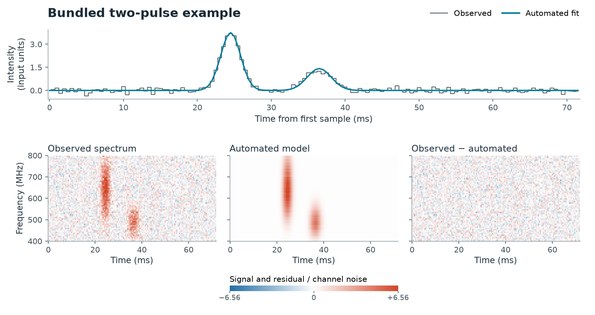
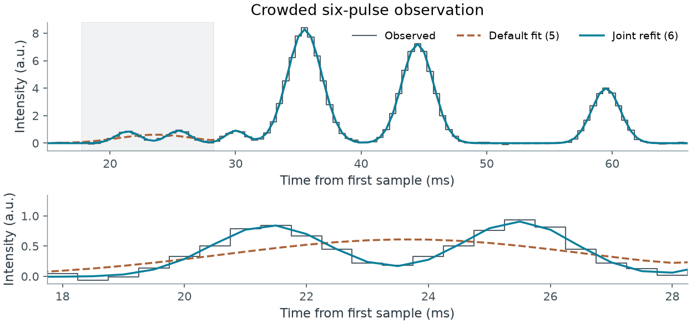

# Fit gallery

## Fast radio burst examples

The automated models were fitted with Burst Surveyor v0.3.0. [Input and prediction checksums for the six observed sources](real-fit-records.json). For the three BaseCat2 comparisons, the saved human fit parameters were evaluated on the same time and frequency grid as the automated model. The panels show the observed intensity, the two models and their residuals. The profiles use the same inverse-variance channel weights. Gray bands mark masked channels. Overlapping model components can describe the same physical pulse.

### Event 156410110

Both fits follow the main peaks. The automated fit uses six components and follows the smaller peak near 16.5 ms more closely than the five-component human reference. [Follow the v0.3.0 worked example through the selected fit.](../README.md#worked-example-for-basecat2-event-156410110)



### Event 300938875

The automated fit recovers a peak near 3.2 ms that is absent from the saved human reference candidate. The atlas records no final human selection for this event. The weaker feature near 4.6 ms remains uncertain.



### Event 1114368517

Both fits use one component and give similar pulse profiles. At 600 MHz, the automated fit selects zero scattering and the human reference gives 0.123 ms. The time bin is 0.655 ms.


### FRB 20190412A

The automated fit uses five components with scattering. The lower panels show the observed dynamic spectrum, model and residual.


## Pulsars

[Pulsar mode](../docs/selection.md#pulsar-profiles) fits one complete rotation, including emission across the phase boundary. Both v0.3.0 pulsar runs use the optional FitBurst exporter for folded profiles.

### J1849+0409

The four-component automated fit and the archived human reference profile follow the main pulse and interpulse. Both profiles use the same intensity zero point.



### J0824+0028

The automated fit uses six components with scattering.



## Bundled two-pulse example

Burst Surveyor v0.3.0 finds a peak at 24.5 ms in the full band and a weaker peak at 36.5 ms in the lower half of the band. It tries both a single scattered pulse and a model with two pulses. [Compare the observation, fits and residuals.](https://immortalari.github.io/burst-surveyor/two-pulse.html)

The single scattered pulse gives a gain of 5417.72. Two Gaussian components give 7085.52, and adding scattering gives 7085.45. The search selects two components without scattering. After refinement their arrival times at 600 MHz are 24.49 and 36.58 ms. [Expected scores and checksum of the bundled NPZ](expected.json)



## Bundled rescue example

[`route-rescue-crowded.npz`](route-rescue-crowded.npz) contains six simulated pulses over Gaussian noise. The v0.3.0 default fit uses five components and blends the peaks at **21.5 ms** and **25.5 ms** into one hump. The router detects the missing structure and jointly refits all six peaks.

```sh
burstsurveyor fit examples/route-rescue-crowded.npz synthetic-fit --workers 1
burstsurveyor route-rescue synthetic-fit examples/route-rescue-crowded.npz synthetic-rescue
burstsurveyor verify synthetic-fit --route-rescue synthetic-rescue
```

The routed result is a `candidate` with six distinct fitted peaks. Weighted squared error falls by about **6.16%** over the full window and by **5.32%** and **4.99%** on the two held-out channel sets under the primary weights. Both held-out checks also improve under the alternate weights. The [generator](make_route_rescue_example.py) can recreate the example in a new file.


